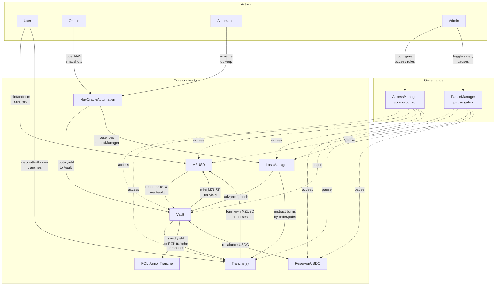
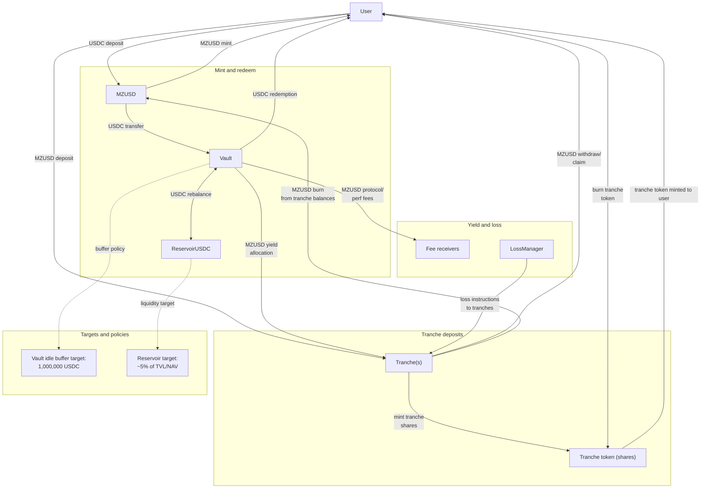
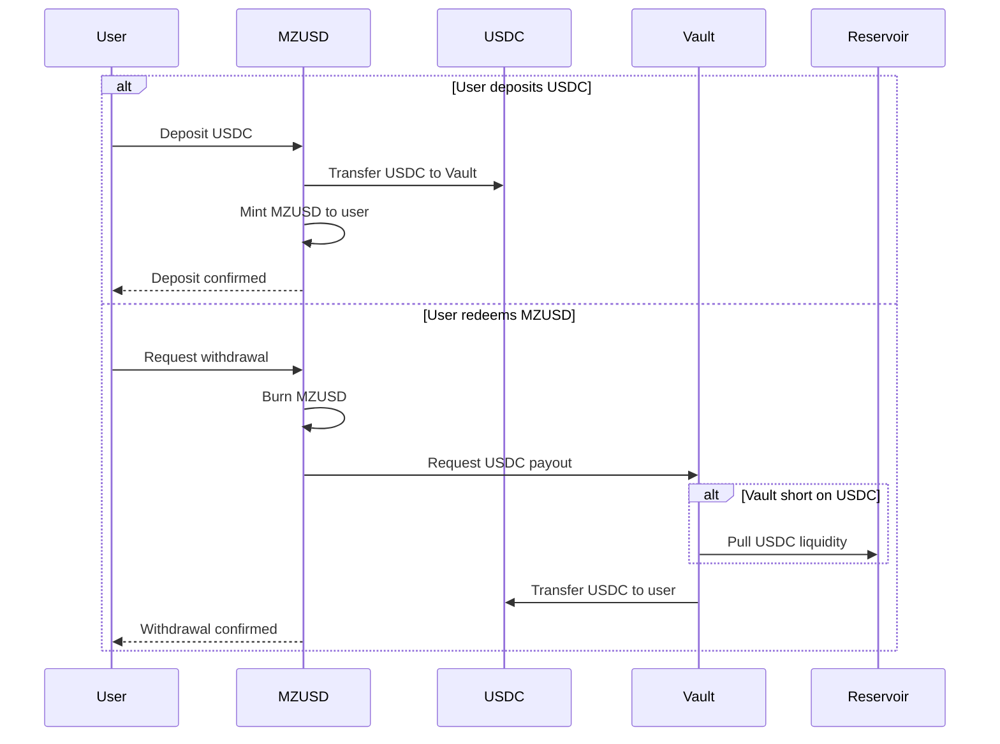
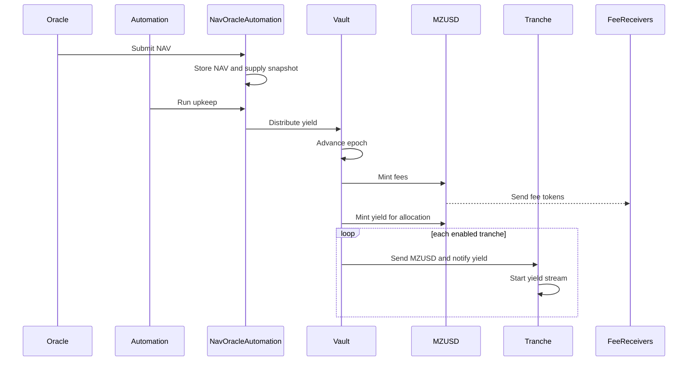
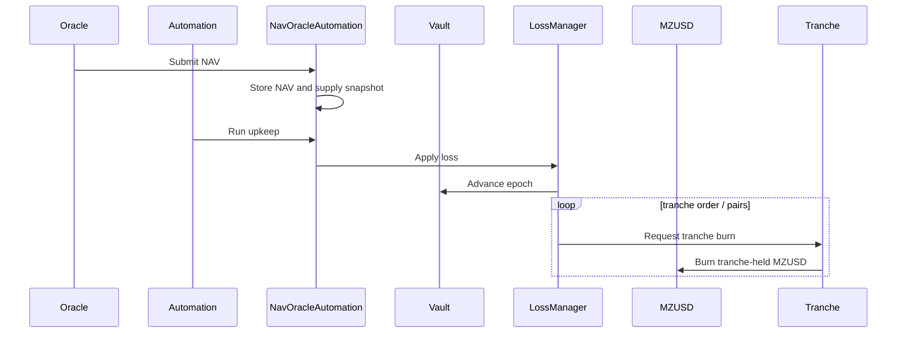
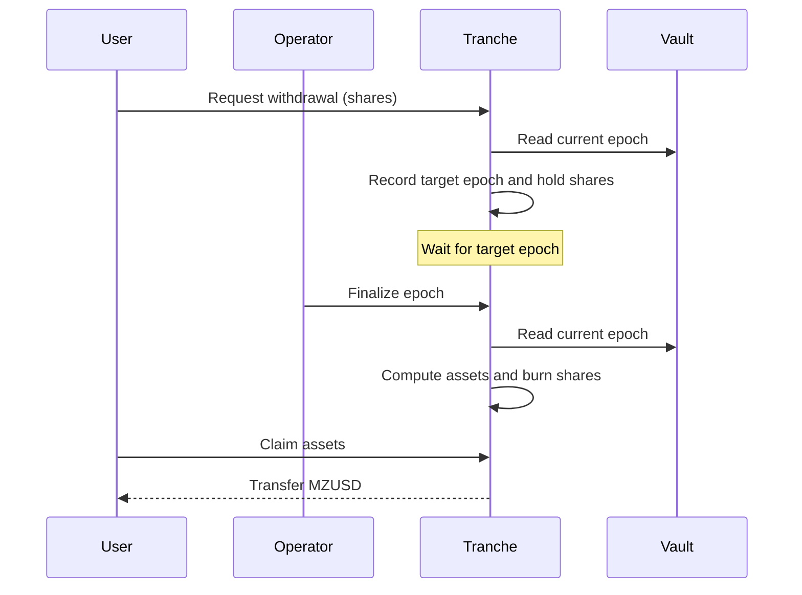
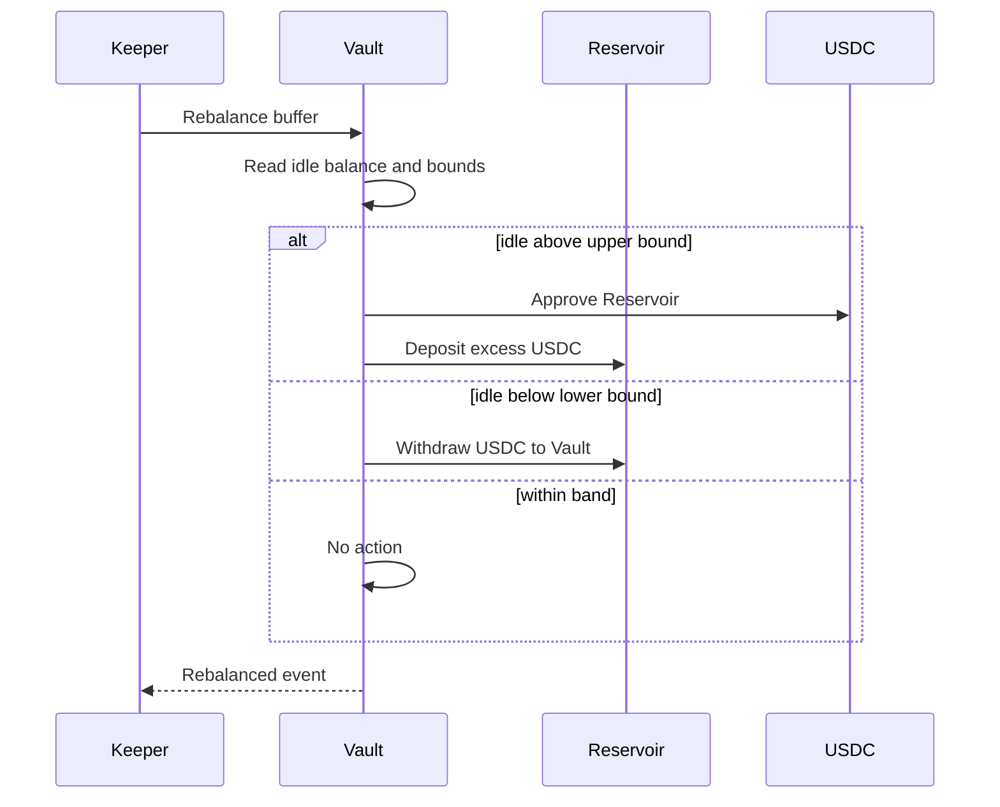

# Protocol Diagrams (WIP)

This file is the home for system and flow diagrams.

## System context

## Token movement (funds flow)

## MZUSD mint and redeem

## Yield distribution (NAV > supply)

## Loss application (NAV < supply)

## Umbrella withdrawal (direct mode disabled)

## Rebalancing buffer and Reservoir

