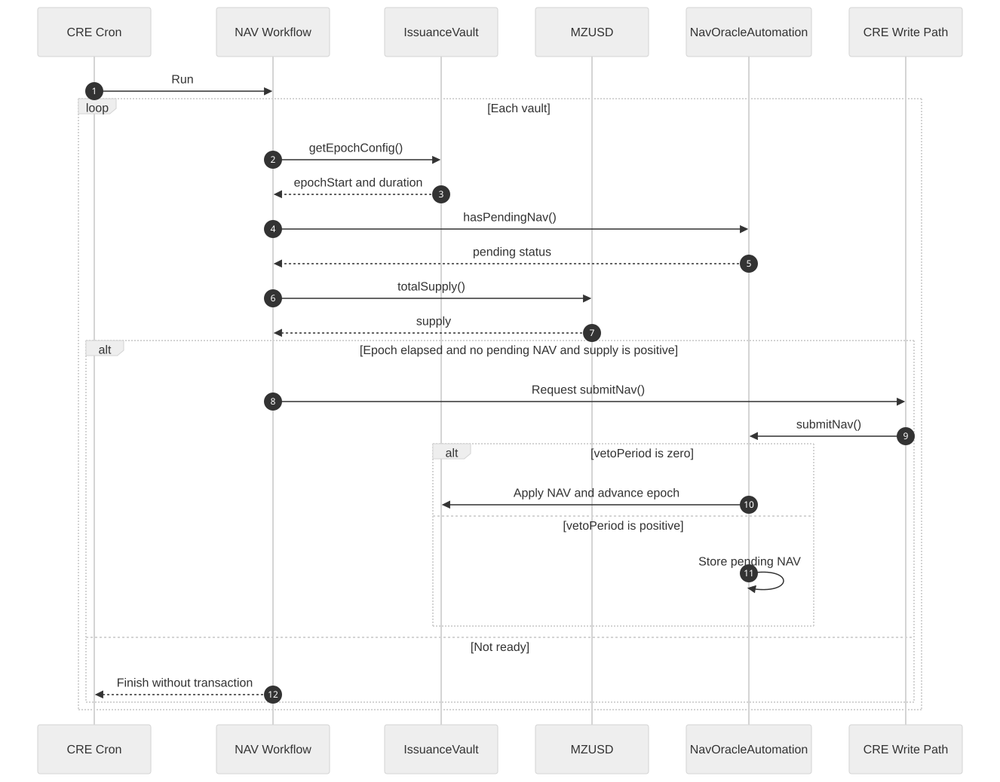
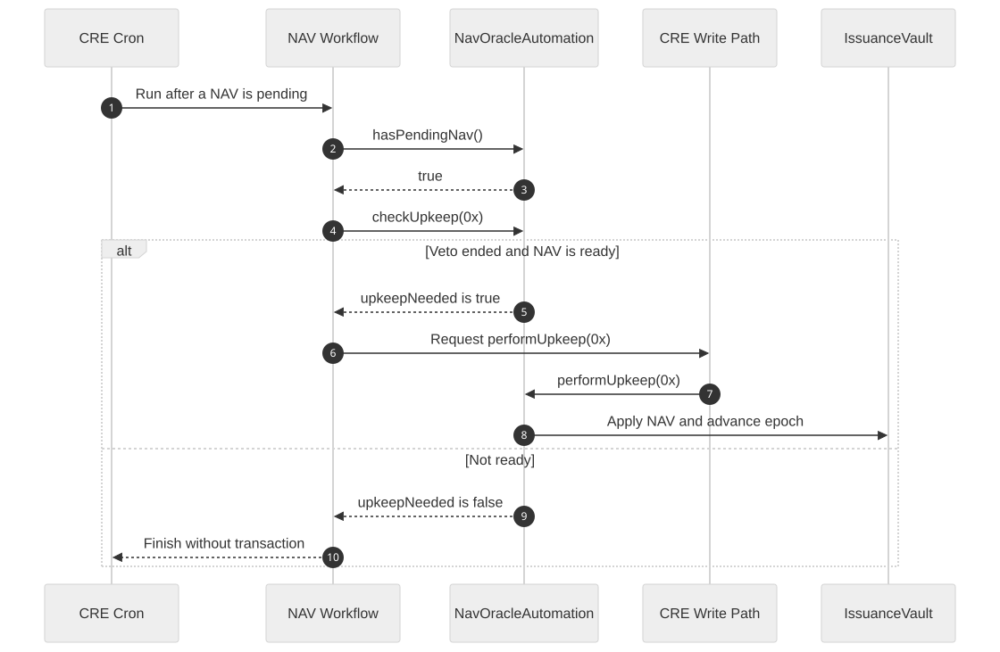
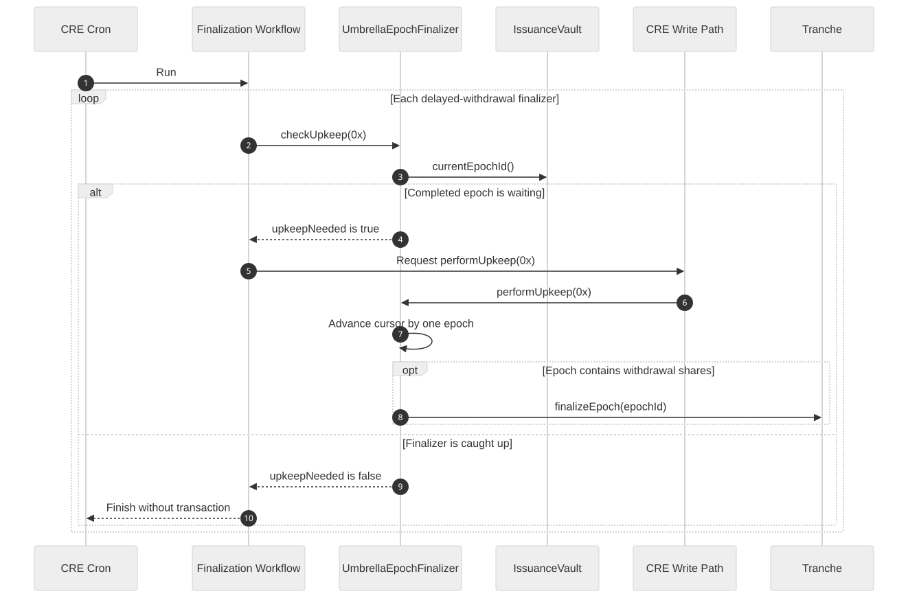
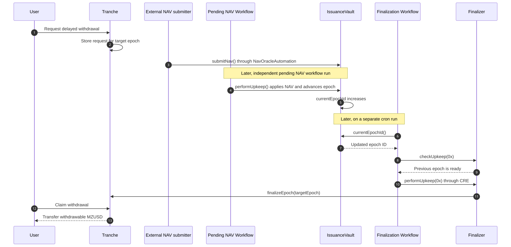

# CRE Automation Flows

This page is a visual reference for the planned Chainlink CRE integration.

## Components


This is the common write path used by both of our workflows:

- The cron trigger starts a workflow inside the CRE DON.
- The workflow reads the existing contracts to decide whether anything is needed.
- If no action is needed, the run ends without a transaction.
- If an action is needed, CRE creates a signed report.
- `KeystoneForwarder` verifies the report and delivers it to our receiver.
- `AutomationReceiver` forwards only an approved function call to an existing contract.

When the receiver calls a restricted function, that function uses `AccessManager` to check
whether the receiver has the required role. The required roles are listed later on this page.

## Flow 1: NAV submission and epoch rollover

CRE will use existing getters to decide whether a
new NAV can be submitted.



Why these calls:

- `getEpochConfig()` tells us whether the current epoch has elapsed.
- `hasPendingNav()` prevents creating a second submission while the previous one is waiting.
- `totalSupply()` prevents a pointless submission before the vault has activity.
- `submitNav()` reads the oracle feeds and keeps the financial calculations in Solidity.

## Flow 2: applying a pending NAV after veto

This branch matters when `vetoPeriod > 0`. With the current Sepolia `vetoPeriod = 0`, `submitNav()`
applies NAV immediately and this branch is normally skipped.



Here `checkUpkeep()` answers one specific question:

> Does a pending NAV already exist, and is it ready to be applied now?

It does not create a NAV submission. `performUpkeep()` applies the pending NAV and causes the epoch
to advance.

## Flow 3: delayed withdrawal finalization

This is a separate workflow. It watches all delayed-withdrawal finalizers.



The finalizer handles at most one epoch per transaction. If it is several epochs behind, later cron
runs continue moving its cursor until it catches up.

## How the workflows coordinate through on-chain state



This is an end-to-end user flow, not a direct message flow between the two workflows. The NAV
workflow advances `IssuanceVault.currentEpochId`. Later, on a separate cron run, the finalization
workflow reads that updated value and discovers that another withdrawal epoch can be finalized.

The workflows never call each other directly. They coordinate through the vault's on-chain state.

Keeping them separate gives us simpler permissions, monitoring, retries, and failure isolation. A
temporary finalizer failure does not block NAV rollover, and a NAV issue does not stop the finalizer
from processing an already completed epoch.

## Receiver permissions

The receiver will need:

- `ORACLE_ROLE` for `NavOracleAutomation.submitNav()`;
- `CHAINLINK_AUTOMATION` for NAV and finalizer `performUpkeep(bytes)` calls.

The receiver must also verify the canonical `KeystoneForwarder`, the expected CRE workflow
identity, and the exact target-selector pair before forwarding anything. A target-selector pair is
an allowed contract address plus an allowed function selector. For example:

```text
(NavOracleAutomation for Vault 1, submitNav())
(NavOracleAutomation for Vault 1, performUpkeep(bytes))
(Vault 1 Senior Finalizer, performUpkeep(bytes))
```

Both values must match the allowlist. This prevents an authorized workflow from changing the target
address or calldata to call a different function or contract.

## Current plan

```text
1. Request CRE deploy access.
2. Add the two CRE workflows to this repository.
3. Add one restricted AutomationReceiver.
4. Test the receiver and both workflows locally with CRE simulation.
5. Deploy and configure the receiver on Sepolia.
6. Deploy both workflows to the CRE DON.
7. Run an end-to-end test: NAV rollover -> epoch advance -> finalization -> claim.
```
## Related code

- [`NavOracleAutomation.sol`](../contracts/automation/NavOracleAutomation.sol)
- [`UmbrellaEpochFinalizer.sol`](../contracts/automation/UmbrellaEpochFinalizer.sol)
- [`IssuanceVault.sol`](../contracts/IssuanceVault.sol)
- [`Tranche.sol`](../contracts/Tranche.sol)